<p align="center">
  <picture>
    <source media="(max-width: 600px) and (prefers-color-scheme: light)" srcset=".github/assets/banner-phone-light.svg">
    <source media="(max-width: 600px)" srcset=".github/assets/banner-phone.svg">
    <source media="(prefers-color-scheme: light)" srcset=".github/assets/banner-light.svg">
    
  </picture>
</p>

<div align="center">

[](https://github.com/yungSNAT/reformed-agent/actions/workflows/ci.yml?query=branch%3Amain) [](https://github.com/yungSNAT/reformed-agent/actions/workflows/audit.yml?query=branch%3Amain) [](https://sonarcloud.io/summary/new_code?id=yungSNAT_reformed-agent)<br>
[](rust-toolchain.toml) [](#licence) [](https://github.com/sheawinkler/hermes-agent-ultra)

[Install](#install) · [Use](#use) · [Against Hermes Agent](#against-hermes-agent) · [Against OpenClaw](#against-openclaw) · [Status](#status) · [Footprint](#footprint) · [What Reformed changes](#what-reformed-changes) · [Documentation](#documentation) · [Development](#development) · [Inherited from Ultra](#inherited-from-hermes-agent-ultra) · [Credits](#credits) · [Licence](#licence)

</div>

Rust-first autonomous agent runtime with functional parity goals against `NousResearch/hermes-agent`. Reformed Agent is a fork of [Hermes Agent Ultra](https://github.com/sheawinkler/hermes-agent-ultra) and keeps its reliability, security and operator-control layer. It installs as Rust binaries and needs no Python or Node.js runtime to run the agent, whilst upstream's source installer adds Python 3.14, Node.js, npm, pnpm, ripgrep and FFmpeg; tools that call another program, such as FFmpeg for video or `npx` for some MCP servers, still need it.

Translations of an earlier README, which predate this fork: [中文](./README_ZH.md), [日本語](./README_JA.md), [한국어](./README_KO.md).

## Install

### From source

```bash
cargo install --git https://github.com/yungSNAT/reformed-agent hermes-cli --locked --bin hermes-agent-ultra --bin hermes-ultra
```

This installs `hermes-agent-ultra` and `hermes-ultra` only, leaving any existing
`hermes` command from upstream NousResearch Hermes untouched. Run setup
afterwards with `hermes-ultra setup`.

### From a checkout

```bash
git clone https://github.com/yungSNAT/reformed-agent.git
cd reformed-agent
bash scripts/install.sh
```

The installer looks for a release asset first. This fork has published none, so
in a checkout with `cargo` available it builds from source instead. Set a custom
install path with `INSTALL_DIR=/usr/local/bin`, and pass `--setup` to run the
setup wizard after installing. Ultra's one-line `curl | bash` install needs a
published release, so it does not work for this fork yet.

Before it unpacks a release asset, the installer checks it against the
release's `SHA256SUMS` and, when `cosign` is on `PATH`, checks that file's
signature from this repository's release workflow for that tag. Set
`HERMES_REQUIRE_SIGNATURE=true` to refuse any install it cannot verify that way.

## Use

Need a shorter path? See [README_QUICKSTART.md](./README_QUICKSTART.md).

Setup:

```bash
hermes-ultra setup
```

Interactive session:

```bash
hermes-ultra
```

Interactive mode is single-instance per Hermes home by default (prevents accidental parallel TUI sessions sharing the same state).  
If you intentionally want parallel interactive sessions, run:

```bash
HERMES_ALLOW_PARALLEL_INTERACTIVE=1 hermes-ultra
```

One-shot query:

```bash
hermes-ultra chat --query "summarize this repository"
```

Gateway mode, in the foreground. Without chat platforms the gateway serves only cron jobs and HTTP webhooks; `hermes-ultra gateway setup` enables platforms:

```bash
hermes-ultra gateway run
```

Deep diagnostics bundle:

```bash
hermes-ultra doctor --deep --snapshot --bundle
```

### Migrating from Hermes

`hermes-ultra migrate` moves a Hermes Agent home into Reformed's:

```bash
hermes-ultra migrate                            # plan only: lists each item and writes nothing
hermes-ultra migrate --apply                    # migrate into a new home
hermes-ultra migrate --apply --into-existing    # add to a home that already exists
```

- It reads `~/.hermes` (`%LOCALAPPDATA%\hermes` on Windows, with `HERMES_DATA_DIR_SUFFIX`) unless `--from` names another home or a profile, and writes Reformed's home unless `--to` names another.
- It moves `config.yaml`, `.env`, the sessions in `state.db`, `memories/`, `skills/`, `SOUL.md`, `plugins/`, `cron/jobs.json` and `scripts/`. It does not move `auth.json`: sign in to each provider again.
- It replaces nothing. An item already in the Reformed home is listed and left unchanged, and a new home is removed again if the run fails. Links are neither followed nor copied, no file content is printed, and on Unix every file written is owner-only.
- Sessions convert as `import-hermes-sessions` converts an export. `state.db` is opened read-only; if it reports unapplied changes, stop Hermes, or start and stop it once.
- Cron jobs are written paused, because Reformed reads schedules in UTC. Cron expressions keep their fields, so check each one's time; interval and one-off jobs keep their times; a job Reformed cannot run the same way is skipped with its reason. Start each with `hermes-ultra cron resume <id>`.

### Importing from Claude Code or Codex

`hermes-ultra import-agent claude-code` or `hermes-ultra import-agent codex` brings that agent's setup into this home:

```bash
hermes-ultra import-agent claude-code            # plan only: lists each item and writes nothing
hermes-ultra import-agent claude-code --apply    # import
hermes-ultra import-agent codex --apply          # the same for Codex
```

- It reads `~/.claude` (Claude Code, with `~/.claude.json` beside it for MCP servers) or `~/.codex` (Codex, with MCP servers from `config.toml`) unless `--source` names another folder. It never reads either agent's credentials.
- `CLAUDE.md`, or Codex's `AGENTS.md` and `memories/*.md`, become entries in `memories/MEMORY.md`, within the memory tool's 2,200-character limit and scan; the old file is backed up first. MCP servers go into `config.yaml` (and `mcp_servers.json` for a command's arguments and environment); Codex's `env_http_headers` and `bearer_token_env_var` become `${VAR}` references. Each skill folder with a `SKILL.md` goes into `skills/claude-code-imports/` or `skills/codex-imports/`.
- It replaces nothing: a server or skill this home already has is listed and left alone. Environment variables and headers whose names look like secrets are left out and named, as are a memory entry or a skill that looks like it holds a credential; add them yourself. Permission rules and custom slash commands have no equivalent here and are listed as skipped.

## Against Hermes Agent

What Reformed has against [Hermes Agent v0.23.1](https://github.com/NousResearch/hermes-agent/releases/tag/v0.23.1) (`3b421578`, released 10 November 2026), checked on 16 November 2026 against this repository's `main` and Hermes's source at that tag. Each cell links its evidence.

| Area | Reformed Agent | Hermes Agent v0.23.1 |
| --- | --- | --- |
| Runtime | One Rust binary; no Python or Node.js ([Footprint](#footprint)) | Python 3.14, Node.js, npm, pnpm, ripgrep and FFmpeg, from its installer ([README](https://github.com/NousResearch/hermes-agent/blob/v0.23.1/README.md?plain=1#L53-L55)) |
| Start-up and size | 35.5 ms cold `--version`; 59.7 MB binary ([Footprint](#footprint)) | 881 ms cold `--version`; 901.6 MB install directory ([Footprint](#footprint)) |
| Install | From source only, with `cargo install` or [`scripts/install.sh`](./scripts/install.sh); no release yet ([Install](#install)) | One-line installers for Linux, macOS, WSL2 and Windows, a Termux APT repository and an MSIX package ([README](https://github.com/NousResearch/hermes-agent/blob/v0.23.1/README.md?plain=1#L35-L61)) |
| Desktop app | None | Hermes Desktop ([`apps/desktop`](https://github.com/NousResearch/hermes-agent/tree/v0.23.1/apps/desktop)) |
| Terminal UI | Yes, on Ratatui ([`hermes-cli/src/tui`](./crates/hermes-cli/src/tui)) | Yes ([README](https://github.com/NousResearch/hermes-agent/blob/v0.23.1/README.md?plain=1#L24)) |
| Chat platforms | 17 built in: BlueBubbles, DingTalk, Discord, Email, Feishu, Home Assistant, Matrix, Mattermost, ntfy, QQ Bot, Signal, Slack, SMS, Telegram, WeCom, Weixin and WhatsApp ([`platforms`](./crates/hermes-gateway/src/platforms), enabled by [`gateway-adapters-all`](./crates/hermes-cli/Cargo.toml)) | 26 bundled, adding A2A, Buzz, Google Chat, IRC, LINE, Photon, Raft, SimpleX, Teams and WhatsApp Cloud ([`plugins/platforms`](https://github.com/NousResearch/hermes-agent/tree/v0.23.1/plugins/platforms)); Home Assistant is an official plugin ([catalogue](https://github.com/NousResearch/hermes-agent/blob/v0.23.1/plugin-catalog/homeassistant.yaml)) |
| API server and webhooks | Yes ([`api_server`](./crates/hermes-gateway/src/platforms/api_server.rs), [`webhook`](./crates/hermes-gateway/src/platforms/webhook.rs)) | Yes ([`api_server.py`](https://github.com/NousResearch/hermes-agent/blob/v0.23.1/gateway/platforms/api_server.py), [`webhook.py`](https://github.com/NousResearch/hermes-agent/blob/v0.23.1/gateway/platforms/webhook.py)) |
| Terminal backends | Local, Docker, SSH and Singularity in every build. Modal and Daytona are left out of the build; configuring one stops commands and file operations with an error rather than running them locally ([`manager.rs`](./crates/hermes-environments/src/manager.rs)) | Local, Docker, SSH, Modal, Daytona and Vercel Sandbox ([`tools/environments`](https://github.com/NousResearch/hermes-agent/tree/v0.23.1/tools/environments)); Singularity is an official plugin ([catalogue](https://github.com/NousResearch/hermes-agent/blob/v0.23.1/plugin-catalog/singularity.yaml)) |
| Importing another agent | From Hermes ([`migrate`](./crates/hermes-cli/src/commands/hermes_migrate.rs), with a dry run by default), Claude Code and Codex ([`import-agent`](./crates/hermes-cli/src/agent_import.rs), likewise) and OpenClaw ([`claw migrate`](./crates/hermes-cli/src/claw_migrate.rs)) | From OpenClaw, Claude Code, Codex, Cursor and others through the official `agent-importers` plugin ([catalogue](https://github.com/NousResearch/hermes-agent/blob/v0.23.1/plugin-catalog/agent-importers.yaml)) |
| Cron, MCP, ACP, skills, subagents | Yes ([`hermes-cron`](./crates/hermes-cron), [`hermes-mcp`](./crates/hermes-mcp), [`hermes-acp`](./crates/hermes-acp), [`hermes-skills`](./crates/hermes-skills), [`delegation.rs`](./crates/hermes-tools/src/tools/delegation.rs)) | Yes ([README](https://github.com/NousResearch/hermes-agent/blob/v0.23.1/README.md?plain=1#L26-L28), [MCP](https://github.com/NousResearch/hermes-agent/blob/v0.23.1/README.md?plain=1#L178), [`acp_adapter`](https://github.com/NousResearch/hermes-agent/tree/v0.23.1/acp_adapter)) |
| Batch trajectories and RL training | None. The `rl_*` training tools and the batch runners behind them were removed: they reported simulated runs and wrote fixed text without calling a model | Yes ([README](https://github.com/NousResearch/hermes-agent/blob/v0.23.1/README.md?plain=1#L30), [`batch_runner.py`](https://github.com/NousResearch/hermes-agent/blob/v0.23.1/batch_runner.py), [`trajectory_compressor.py`](https://github.com/NousResearch/hermes-agent/blob/v0.23.1/trajectory_compressor.py)) |
| Documentation | This README and the guides under [Documentation](#documentation), in the repository; no published site | A site at [hermes-agent.nousresearch.com/docs](https://hermes-agent.nousresearch.com/docs/) |
| Licence | MIT for the fork's contributions ([LICENSE](./LICENSE)) | MIT ([LICENSE](https://github.com/NousResearch/hermes-agent/blob/v0.23.1/LICENSE)) |

Slash-command and surface parity is measured against upstream v0.23.2, the pinned revision; see [Status](#status).

## Against OpenClaw

What Reformed has against [OpenClaw v2026.11.4](https://github.com/openclaw/openclaw/releases/tag/v2026.11.4) (`d843d6af`, released 16 November 2026), checked on 16 November 2026 against this repository's `main` and OpenClaw's source at that tag. Each cell links its evidence.

| Area | Reformed Agent | OpenClaw v2026.11.4 |
| --- | --- | --- |
| Runtime | One Rust binary; no Python or Node.js ([Footprint](#footprint)) | Node.js 24.16 or later, or 26.1 or later; its installers provide one when needed ([README](https://github.com/openclaw/openclaw/blob/v2026.11.4/README.md?plain=1#L26-L41)) |
| Start-up and size | 46.7 ms cold `--version`; 44.8 MB binary ([Footprint](#footprint), measured against v2026.11.3) | 577 ms cold `--version`; 546.8 MB npm prefix, at v2026.11.3 ([Footprint](#footprint)) |
| Install | From source only; no release yet ([Install](#install)) | Installers for macOS, Linux, WSL2 and Windows, and the `openclaw` npm package ([README](https://github.com/openclaw/openclaw/blob/v2026.11.4/README.md?plain=1#L24-L47)) |
| Desktop and mobile apps | None | Apps for macOS, iOS, Android, Windows and Linux ([README](https://github.com/openclaw/openclaw/blob/v2026.11.4/README.md?plain=1#L18), [`apps`](https://github.com/openclaw/openclaw/tree/v2026.11.4/apps)) |
| Chat platforms | 17 built in ([Against Hermes Agent](#against-hermes-agent)); OpenClaw has no channel for BlueBubbles, DingTalk, Home Assistant, ntfy, QQ Bot, WeCom or Weixin | 25 bundled channel plugins, adding Buzz, ClickClack, Google Chat, iMessage, IRC, LINE, Microsoft Teams, Nextcloud Talk, Nostr, Raft, Synology Chat, Tlon, Twitch, X, Zalo and Zalo Personal (the plugins in [`extensions`](https://github.com/openclaw/openclaw/tree/v2026.11.4/extensions) whose `openclaw.plugin.json` has the `channels` category); email arrives through an IMAP trigger ([`imap`](https://github.com/openclaw/openclaw/blob/v2026.11.4/extensions/imap/openclaw.plugin.json)) |
| Importing another agent | From Hermes ([`migrate`](./crates/hermes-cli/src/commands/hermes_migrate.rs)), Claude Code and Codex ([`import-agent`](./crates/hermes-cli/src/agent_import.rs)) and OpenClaw ([`claw migrate`](./crates/hermes-cli/src/claw_migrate.rs)) | From Hermes, Claude Code and Claude Desktop ([`migrate-hermes`](https://github.com/openclaw/openclaw/blob/v2026.11.4/extensions/migrate-hermes/openclaw.plugin.json), [`migrate-claude`](https://github.com/openclaw/openclaw/blob/v2026.11.4/extensions/migrate-claude/openclaw.plugin.json)) |
| Licence | MIT for the fork's contributions ([LICENSE](./LICENSE)) | MIT ([LICENSE](https://github.com/openclaw/openclaw/blob/v2026.11.4/LICENSE)) |

## Status

- **Base:** Hermes Agent Ultra [`v0.22.0`](./docs/releases/v0.22.0.md) at commit `c002f8c4`.
- **Releases:** none published from this fork yet. Build from source (see [Install](#install)).
- **Names:** the binaries keep Ultra's names, `hermes-agent-ultra` and `hermes-ultra`, and its config home, `~/.hermes-agent-ultra`.
- **Parity:** measured against the upstream revision pinned in [`docs/parity/upstream-reference.txt`](./docs/parity/upstream-reference.txt) (`ae2a81cc`, v0.23.2, 16 November 2026). There this repository carries 87 of upstream's 105 slash commands (16 not ported, 2 left out by design; [`slash-command-divergence.json`](./docs/parity/slash-command-divergence.json)) and 1,345 of upstream's 3,132 files under `skills`, `optional-skills`, `plugins`, `website` and `ui-tui` (42.9%); each missing file falls under a documented rule, with its reason, in [`intentional-divergence.json`](./docs/parity/intentional-divergence.json). Of the 1,508 files both trees have that differ from upstream's, 27 are not yet shown to match in Rust. Of the upstream tests and TUI files the 3 coverage manifests track, 141 have no Rust test cited for their cases, and 337 cite Rust tests chosen before upstream changed those files and not rechecked since. All 3 groups are counted, each row with its reason, in [`shared-diff-backlog.md`](./docs/parity/shared-diff-backlog.md) and the coverage manifests, and the release gate in [`global-parity-proof.md`](./docs/parity/global-parity-proof.md) fails until they are resolved.
- **Drift:** upstream has moved since the pin. The daily [Parity Audit](https://github.com/yungSNAT/reformed-agent/actions/workflows/parity-audit.yml) run reports the current gap against upstream `main` in its job summary.
- **Windows:** hosted CI only cross-builds for Windows. The tests of `hermes-config`, `hermes-cron`, `hermes-environments` and `hermes-tools` pass in a local Windows run (`cargo test -p hermes-config -p hermes-cron -p hermes-environments -p hermes-tools`); the other crates' tests have not been run on Windows. Local shell commands and cron scripts need a POSIX `sh` from Git for Windows or MSYS2 on PATH. They run without shell init files.
- **Code analysis:** the [SonarCloud](https://sonarcloud.io/project/overview?id=yungSNAT_reformed-agent) ratings cover the Rust crates in `crates/` and the other files outside the excluded paths. Content inherited from Ultra (`scripts/`, `skills/`, `optional-skills/`, `ui-tui/`, `plugins/`, `tests/` and `website/`) and the vendored crates in `third_party/` are excluded from analysis; [`.sonarcloud.properties`](./.sonarcloud.properties) lists each path and why.

## Footprint

Measured on 13 November 2026 against Hermes Agent v0.23.1 and on 15 November 2026 against OpenClaw v2026.11.3.

| Measure | Reformed Agent at `5cdde8fd` | Hermes Agent v0.23.1 (`3b421578`) |
| --- | --- | --- |
| Installed size | 59.7 MB binary (21.0 MB as the release `.tar.gz`) | 901.6 MB install directory, 2.68 GB home after install |
| `--version`, cold page cache | 35.5 ms, 13.9 MiB peak RSS | 881 ms, 36.5 MiB peak RSS |
| `--version`, warm | 4.6 ms, 13.9 MiB | 353 ms, 37.0 MiB |
| `doctor`, cold page cache | 55.0 ms, 14.2 MiB | not comparable (see below) |
| `doctor`, warm | 9.2 ms, 14.3 MiB | not comparable |

Method:

- Machine: one x86_64 Linux machine (AMD Ryzen 7 4800H, 4 CPU threads available to the run, 31 GiB RAM) running CachyOS with Linux 7.3.3 and rustc 1.99.1. It was not idle: the load average was 2.46 before the runs and 2.35 after.
- Network: none. Both tools ran in a network namespace with no interfaces up, each in its own scratch home (empty before the first run for Reformed, as the installer left it for Hermes), with no account or key.
- Builds: Reformed was built with `cargo build --locked --release -p hermes-cli --bin hermes-agent-ultra`. Hermes was installed by its own installer (`install.sh --non-interactive --skip-browser --skip-computer-use`).
- Figures: wall-clock medians of 5 cold runs (page cache dropped before each) and 10 warm runs. Peak RSS is the largest resident set of any process in the run.
- Hermes `doctor`: it runs 44 network connectivity checks, so offline it took about 95 s and exited 1. That is not a start-up time.

Against OpenClaw, measured on 15 November 2026 on the same machine with the same method except as noted:

| Measure | Reformed Agent at `a9fa2077` | OpenClaw v2026.11.3 |
| --- | --- | --- |
| Installed size | 44.8 MB binary | 546.8 MB npm prefix, 332.9 MB home after install |
| `--version`, cold page cache | 46.7 ms, 12.4 MiB peak RSS | 577 ms, 65.8 MiB peak RSS |
| `--version`, warm | 5.2 ms, 12.3 MiB | 98.2 ms, 66.2 MiB |

- OpenClaw was installed by the npm route in its README (`npm install -g openclaw@2026.11.3 --allow-scripts=openclaw`) into a scratch prefix and home, with the machine's Node.js v26.13.1, which the installed size leaves out. Both tools ran with an empty scratch home.
- The machine was busier than for the Hermes table: the load average was 7.19 before the runs and 5.28 after, so Reformed's figures here differ from the table above.

These are start-up and size figures from 1 machine, not a general speed comparison.

## What Reformed changes

- `Reformation skin`: the default terminal theme, a palette for a pure black canvas
- `Hermes history import`: `hermes-ultra import-hermes-sessions <export.jsonl> --profile-dir <dir>` converts a Hermes JSONL session export into resumable, searchable sessions in a new profile
- `Hermes home migration`: `hermes-ultra migrate` (see [Migrating from Hermes](#migrating-from-hermes))
- `Tool guard`: `security.tool_guard` names a program that speaks Claude Code's PreToolUse hook format; when it is set, local terminal commands, `write_file`, `patch` and cron scripts ask it first and run only on a clean allow (see [security.md](./website/docs/user-guide/security.md))
- `Stream lifetime cap`: `agent.stream_max_lifetime`, ported from Hermes
- `Pinned parity reference`: the parity gates compare against one recorded upstream revision, so a day's upstream commits cannot fail an unrelated change
- `Provider routing`: retries keep the configured endpoint and provider-specific credentials. Vertex AI supports service-account credentials and application default credentials.
- `Gateway replies`: API replies keep the final answer after tool progress messages and handle streaming previews and UTF-8 chunks.
- `Browser tools`: local and cloud browsers use Chrome DevTools Protocol, with HTTP discovery for cloud sessions and screenshot analysis through the configured vision model.
- `Windows`: cron scripts and local shell commands find `sh` through the inherited PATH, cron refuses rooted and drive-relative script paths, text-to-speech command providers run without a shell and debug builds of the CLI no longer overflow the stack.
- `Container image`: the Dockerfile builds with the pinned toolchain and the image runs as an unprivileged user.
- `Lint gate`: `cargo clippy --workspace --all-targets -- -D warnings` passes on Linux and Windows, and the warning allowlist is empty.

## Documentation

Guides for this fork live in the repository; there is no published documentation site yet.

- [README_QUICKSTART.md](./README_QUICKSTART.md): install, setup and a first session.
- [Installer troubleshooting](./docs/installer-troubleshooting.md): `command not found` and other install problems.
- [MCP](./docs/mcp.md): connecting MCP servers, and serving Reformed's tools over MCP.
- [Local backends](./docs/local-backends.md): local and self-hosted model endpoints.
- [Session lifecycle](./docs/session-lifecycle.md): where sessions live and who owns them.
- [Security](./website/docs/user-guide/security.md): command approval, the tool guard and other controls.
- [Demo and readiness](./docs/demo.md): the source-tree proof path.
- [Parity reports](./docs/parity/README.md) and [upstream sync](./docs/upstream-sync.md): how parity is measured and upstream changes are brought in.
- [CONTRIBUTING.md](./CONTRIBUTING.md): development setup, PR rules and the no-stub gate.

The user guide under [`website/docs`](./website/docs) is inherited from Hermes Agent and Ultra and is only partly updated for this fork. Where it disagrees with this README, the README describes this fork; for example, its configuration page lists 7 terminal backends, but this fork's build has 4: local, Docker, SSH and Singularity (see [Against Hermes Agent](#against-hermes-agent)).

## Development

Repo-local CI is the authoritative gate for development and release confidence.
GitHub Actions are a hosted mirror of the repo contract when they run; they are
not required as the source of truth.

```bash
CARGO_TARGET_DIR=${CARGO_TARGET_DIR:-target} bash scripts/run-repo-ci.sh
```

The Rust toolchain is pinned in [`rust-toolchain.toml`](./rust-toolchain.toml). See [docs/demo.md](./docs/demo.md) for the one-command demo/readiness path.

Interested in helping? Start with [CONTRIBUTING.md](./CONTRIBUTING.md) for setup, PR expectations, parity rules, and the no-stub completeness gate.

## Inherited from Hermes Agent Ultra

Everything in this section is inherited from Ultra and describes the runtime this fork builds on.

### What You Get

- Fully Rust-native core runtime (agent loop, tools, gateway, skills, CLI/TUI)
- Multi-provider inference routing and OAuth-capable provider flows
- First-class local/self-host backends: Ollama, llama.cpp/llamafile, vLLM, MLX, Apple ANE endpoint, SGLang, TGI, LM Studio, LMDeploy, LocalAI, KoboldCpp, text-generation-webui, TabbyAPI
- Tool runtime with policy enforcement, MCP integration, cron, and memory backends
- Parity upkeep system for upstream drift triage and controlled roll-forward
- Production operations surface (`doctor`, replay traces, sync gates, parity artifacts)

### Why Ultra Exists

`NousResearch/hermes-agent` is the canonical upstream product surface.  
Hermes Agent Ultra keeps that surface in scope while focusing on:

- deterministic Rust execution paths
- explicit safety and policy controls
- better observability and incident debugging
- easier operator workflows for long-running local and gateway sessions

### Differentiation vs Upstream

Ultra keeps parity work separate from intentional extensions.

- `Runtime policy engine`: enforce/audit/simulate tool policy decisions at runtime
- `Session branching + time-travel`: checkpoint/rollback/replay navigation from the TUI
- `Tool-call simulator`: preview policy allow/deny outcomes before running risky tool invocations
- `Adaptive repo-review budget controls`: tune discovery-loop trimming live (`balanced/aggressive/relaxed/off`)
- `Semantic repo graph`: inspect dependency hubs/edges with inline Mermaid preview
- `Provider QoS router controls`: inspect route learning/health and apply autotune from chat
- `Live session eval harness`: score real saved sessions and gate quality trends from actual usage
- `RTK raw-mode controls`: inspect unwrapped tool payloads when debugging integrations
- `Memory fusion`: ContextLattice + external memory providers with scoring/fusion logic
- `One-true-harness cockpit`: `/harness` and `harness_cockpit` unify skills, proof, OIDC, replay, objectives, onboarding, and chaos probes
- `Ultra autonomy cockpit`: `ultra_autonomy`, `/harness autonomy`, and `harness.autonomy` expose task boards, loop detection, resource-governed subagents, ContextLattice-first memory lifecycle, channel surfaces, and objective-to-board planning
- `One-command always-on UX`: `hermes-ultra up` composes gateway service install/start/status into a single operator command
- `Advanced sync gates`: differential parity checks, red-team/adversarial gating, elite sync gate
- `Operational tooling`: deep doctor snapshots, replay traces, queue-based upstream webhook sync
- `Rust-only implementation strategy`: parity in Rust first; no direct Python runtime vendoring

### Memory Setup

Mem0 memory setup supports cloud, self-hosted, and OSS-style endpoints:

```bash
hermes-ultra memory setup mem0 --mode selfhosted --host http://127.0.0.1:24220 -y
```

Add `--api-key ...` only when the self-hosted server requires auth; Hermes writes the host to `mem0.json` and the secret to `$HERMES_HOME/.env`.

### Skip API-key collection With Nous Portal

Hermes Agent Ultra still supports direct provider and per-tool keys. If you prefer one managed subscription for model access plus hosted tool backends, [Nous Portal](https://portal.nousresearch.com) can cover:

- 300+ models, selectable with `/model <name>`.
- Tool Gateway routing for web search, image generation, text-to-speech, and cloud browser backends.

Fresh install path:

```bash
hermes-ultra setup --portal
```

That starts Nous OAuth setup, sets Nous as the provider, and enables Tool Gateway routing. Inspect the current state with:

```bash
hermes-ultra portal info
```

You can still bring your own keys for individual tools; gateway routing is per backend, not all-or-nothing.

### Operator Commands

Optional Sentrux MCP profile:

Full MCP guide: [docs/mcp.md](./docs/mcp.md)

```bash
hermes-ultra mcp sentrux
hermes-ultra mcp sentrux-status
```

Key operator commands:

```bash
# Capability diagnostics for current or target model
/model explain
/model why-not --cap tools,reasoning --min-context 200000
/swarm status
/swarm plan graph
/swarm run 4 sequential

# Deterministic trace controls
/raw trace status
/raw trace verify
/raw trace export 200

# Runtime policy packs
/policy list
/policy strict
/policy standard
/policy dev

# Adaptive intelligence-performance autopilot
/ops autopilot status
/ops autopilot run
/ops autopilot recommend
/ops autopilot apply

# OpenHuman-derived P0/P1 operator control-plane
/commands search boot
/boot quick
/boot profile prod
/walkthrough start quick
/walkthrough insights
/integrations status
/integrations repair
/integrations snapshot
/triage eval webhook "secret leak panic outage"
/triage feedback webhook critical "secret leak panic outage"
/subconscious status
/subconscious profile strict
/subconscious run 2 --dry-run
/compress rules recommend
/compress rules autotune apply user

# Session time-travel + simulation
/timetravel list
/timetravel goto <snapshot>
/simulate terminal {"cmd":"ls -la"}

# QoS + eval runtime surfaces
/qos status
/qos health
/ops budget balanced
/ops eval run
```

### Local Backends

`hermes-ultra setup` now includes local/self-host provider options with no mandatory API key:

- `ollama-local` (default `http://127.0.0.1:11434/v1`)
- `llama-cpp` (default `http://127.0.0.1:8080/v1`)
- `vllm` (default `http://127.0.0.1:8000/v1`)
- `mlx` (default `http://127.0.0.1:8080/v1`)
- `apple-ane` (default `http://127.0.0.1:8081/v1`)
- `sglang` (default `http://127.0.0.1:30000/v1`)
- `tgi` (default `http://127.0.0.1:8082/v1`)
- `lmstudio` (default `http://127.0.0.1:1234/v1`)
- `lmdeploy` (default `http://127.0.0.1:23333/v1`)
- `localai` (default `http://127.0.0.1:8080/v1`)
- `koboldcpp` (default `http://127.0.0.1:5001/v1`)
- `text-generation-webui` (default `http://127.0.0.1:5000/v1`)
- `tabbyapi` (default `http://127.0.0.1:5000/v1`)

Override endpoint URLs via env vars:

- `OLLAMA_BASE_URL`
- `LLAMA_CPP_BASE_URL`
- `VLLM_BASE_URL`
- `MLX_BASE_URL`
- `APPLE_ANE_BASE_URL`
- `SGLANG_BASE_URL`
- `TGI_BASE_URL`
- `LMSTUDIO_BASE_URL`
- `LMDEPLOY_BASE_URL`
- `LOCALAI_BASE_URL`
- `KOBOLDCPP_BASE_URL`
- `TEXT_GENERATION_WEBUI_BASE_URL`
- `TABBYAPI_BASE_URL`

Detailed guide: [docs/local-backends.md](./docs/local-backends.md)

### Built-In Context + Memory Behavior

Ultra auto-loads high-value project and persona context:

- `SOUL.md`
- `AGENTS.md`
- `DESIGN.md`
- `.hermes.md` / `HERMES.md`
- `MEMORY.md` / `USER.md`

Subdirectory discovery is enabled so context follows the code path being edited.

### Skills and Registry Surface

Skills commands support multi-registry search/install and local tap flows.

- Default GitHub skill taps include OpenAI, Anthropic, VoltAgent, Matt Pocock,
  Addy Osmani, Google, Obsidian, design-skill, Loopy, GitHub Copilot, gstack,
  and MiniMax roots where those repos expose a clear skill directory.
- Registry-aware installs include:
  - `official/...`
  - `skills.sh/...`
  - `github/...`
  - `lobehub/...`
  - `clawhub/...`
  - `claude-marketplace/...`
- Mandatory skill security scanning runs before install and before use.

Use `/harness` in the TUI or the `harness_cockpit` tool for the curated
one-true-harness index, including Matt Pocock `teach`, `domain-modeling`,
`grill-with-docs`, `codebase-design`, and architecture-deepening workflows.
Use `/harness autonomy` or the `ultra_autonomy` tool for board execution,
loop detection, resource admission, ContextLattice-first memory lifecycle, and
objective-to-board planning. Dashboard clients can call `harness.autonomy` via
`/v1/rpc`; see [Ultra Autonomy Surfaces](./docs/ultra-autonomy-surfaces.md).

### Dashboard OIDC

`hermes-http` supports a Rust-native dashboard OIDC mode while preserving
`HERMES_HTTP_API_KEY` bearer access for machine clients.

Minimum OIDC env:

```bash
HERMES_DASHBOARD_AUTH_PROVIDER=oidc
HERMES_DASHBOARD_OIDC_ISSUER=https://issuer.example
HERMES_DASHBOARD_OIDC_CLIENT_ID=hermes-dashboard
HERMES_DASHBOARD_SESSION_SECRET='replace-with-strong-random-secret'
```

Optional env includes `HERMES_DASHBOARD_OIDC_CLIENT_SECRET`,
`HERMES_DASHBOARD_OIDC_REDIRECT_URI`, `HERMES_DASHBOARD_OIDC_SCOPES`,
`HERMES_DASHBOARD_OIDC_ALLOWED_EMAILS`, `HERMES_DASHBOARD_OIDC_ALLOWED_DOMAINS`,
`HERMES_DASHBOARD_COOKIE_SECURE`, and explicit authorization/token/JWKS endpoint
overrides.

OpenHuman runbooks and matrices:
- `docs/implementation/openhuman-p0-p1-runbook.md`
- `docs/implementation/openhuman-p0-p1-surface-matrix.md`
- `docs/implementation/openhuman-p2a-p2b-runbook.md`
- `docs/implementation/openhuman-p2a-p2b-surface-matrix.md`
- `docs/implementation/openhuman-p3-swarms-runbook.md`
- `docs/implementation/openhuman-p3-swarms-surface-matrix.md`

### Security Posture

- Skill content security scanning blocks dangerous patterns and restricted URL targets
- Skill guard modes: `strict` (default), `relaxed` (only blocks destructive `rm` ops), `off`
- Policy-controlled tool execution modes: `off`, `audit`, `simulate`, `enforce`
- Tool policy presets: `strict`, `balanced`, `dev`, `relaxed`
- Sensitive field redaction in traces/log surfaces
- Loaded secret values are matched exactly, whatever their shape. A loaded secret is the value of an environment variable whose name names a credential (`*_API_KEY`, `*_TOKEN`, `*_SECRET`, `*PASSWORD`, `*_PASS`, `*_AUTH`, `Authorization` and similar; not `*_PATH`, `*_FILE`, `*_URL` or `*_ID`), whether it came from the profile's `.env`, a vault or the shell, or a credential-named value in `config.yaml`. Values under 8 characters, short words, paths, `${VAR}` references and documented placeholders such as `not-needed` or `lm-studio` do not count. Tool output and redacted text show `***` in place of the value, so a file read through a tool shows `***` and writing it back whole would store `***`. A tool call whose arguments contain the value is refused, naming the variable or config key but not the value. There is no allow-list: to use such a value in a tool call on purpose, rename or unset the variable, or move the value out of the credential-named key. Encoded or split copies are not matched, and tokens held only in the auth stores are covered by shape redaction alone.
- Guardrails for path traversal, unsafe file ops, and runtime boundary violations

Operator runtime overrides (env):

- `HERMES_SKILL_GUARD_MODE=relaxed`
- `HERMES_SKILL_LOAD_GUARD_MODE=relaxed` (scan mode for skills already on disk when loaded for use; `strict`, `relaxed` or `off`, unknown values mean `strict`; when unset, loading follows `HERMES_SKILL_GUARD_MODE`, which still governs install and creation)
- `HERMES_TOOL_POLICY_PRESET=relaxed`
- `HERMES_MAX_TURNS_UNLIMITED=1` (or set `max_turns: 0` in config/profile)
- `HERMES_FORCE_RUNTIME_AUTH_REFRESH=1`
- `HERMES_AUTH_REFRESH_MAX_RETRIES=6`

### Upstream Sync and Parity Upkeep

Ultra uses controlled sync workflows, not blind merges.

- Upstream source of truth: `NousResearch/hermes-agent`
- Fetch/sync tooling:
  - `scripts/sync-upstream.sh`
  - `scripts/upstream_webhook_sync.py`
- Parity artifacts:
  - `docs/parity/`
  - `.sync-reports/`

Note: this repository intentionally tracks parity via queue/gate workflows because upstream and ultra history can diverge materially.

### Architecture Map

Primary Rust workspace crates:

- `crates/hermes-agent`: agent loop, memory orchestration, provider control
- `crates/hermes-tools`: tool registry and execution backends
- `crates/hermes-cli`: CLI/TUI, setup, model/personality switching, operator commands
- `crates/hermes-gateway`: gateway adapters and live runtime paths
- `crates/hermes-skills`: skill storage, guardrails, hub and registry pathways
- `crates/hermes-mcp`: MCP transport/client/server support
- `crates/hermes-config`: config model and runtime loading
- `crates/hermes-telemetry`: tracing and metrics surfaces

## Credits

Canonical/official upstream references:

- Upstream (official): https://github.com/NousResearch/hermes-agent
- Ultra (the project this repository forks): https://github.com/sheawinkler/hermes-agent-ultra
- Ultra fork archive (historical): https://github.com/sheawinkler/hermes-agent-rs-fork
- Reformed Agent (this repository): https://github.com/yungSNAT/reformed-agent

Integrated ecosystem references used in Ultra workflows:

- OpenAI skills repository: https://github.com/openai/skills
- Anthropic skills repository: https://github.com/anthropics/skills
- VoltAgent skills aggregation: https://github.com/VoltAgent/awesome-agent-skills
- Ratatui (TUI foundation): https://github.com/ratatui/ratatui
- tui-textarea (composer/editor behavior): https://github.com/rhysd/tui-textarea

Additional ownership, provenance, and credit notes are maintained in [UPSTREAM_ATTRIBUTION.md](./UPSTREAM_ATTRIBUTION.md).

The banner's lettering uses Cascadia Mono and Besley glyphs (SIL OFL 1.1); its anvil emblem is hand-drawn pixel art.

## Licence

Distributed under this repository's license and notices: the MIT licence in [LICENSE](./LICENSE) covers contributions made in the fork after it diverged from its upstream, and does not relicense upstream-authored work.  
See [LICENSE](./LICENSE), [NOTICE](./NOTICE), and [UPSTREAM_ATTRIBUTION.md](./UPSTREAM_ATTRIBUTION.md).

---

<p align="center"><sub>Post tenebras lux.<br>Made by <a href="https://github.com/yungSNAT">yungSNAT</a>. <i>Ad gloriam eius, non meam.</i></sub></p>
